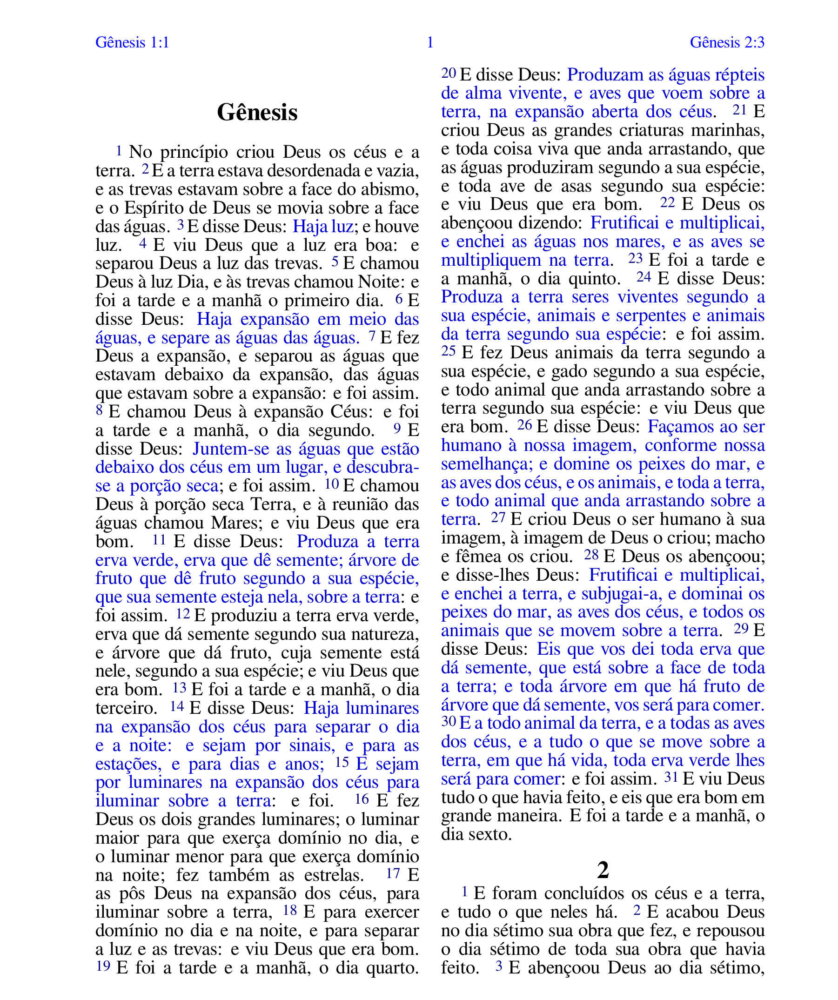

# BibliaLegendada
==================

<!--  -->
</img>

Bíblia Livre com adição de 'legendas'. A legenda consiste no uso de cores para melhor ilustração do discurso de cada personagem. 

## Propósito

Auxiliar leitores na compreensão e cultivar ainda mais o interesse pelos diálogos, parábolas e interlocuções presentes no texto bíblico.

## Ferramentas

O texto é formatado utilizando LaTeX (LuaLaTeX) para uma melhor organização e facilidade de execução de um texto tão imenso e detalhado.

Foram utilizados alguns Shell Scripts com expressões regulares para manipulação de caracteres.

## Progresso

### AT
### 📖 Livros do Antigo Testamento

<table>
  <tr>
    <!-- Coluna 1 -->
    <td valign="top" style="white-space: nowrap; padding-right: 20px;">
      ☑ Gênesis 
      ☑ Êxodo 
      ☑ Levítico 
      ☑ Números 
      ☑ Deuteronômio 
      ☑ Josué 
      ☑ Juízes 
      ☑ Rute 
      ☑ 1 Samuel 
      ☑ 2 Samuel 
      ☑ 1 Reis 
      ☑ 2 Reis 
      ☑ 1 Crônicas
    </td>
    <!-- Coluna 2 -->
    <td valign="top" style="white-space: nowrap; padding-right: 20px;">
      ☑ 2 Crônicas 
      ☑ Esdras 
      ☑ Neemias 
      ☐ Ester 
      ☐ Jó 
      ☐ Salmos 
      ☐ Provérbios 
      ☐ Eclesiastes 
      ☐ Cantares 
      ☐ Isaías 
      ☐ Jeremias 
      ☐ Lamentações 
      ☐ Ezequiel
    </td>
    <!-- Coluna 3 -->
    <td valign="top" style="white-space: nowrap; padding-right: 20px;">
      ☐ Daniel 
      ☐ Oseias 
      ☐ Joel 
      ☐ Amós 
      ☐ Obadias 
      ☐ Jonas 
      ☐ Miqueias 
      ☐ Naum 
      ☐ Habacuque 
      ☐ Sofonias 
      ☐ Ageu 
      ☐ Zacarias 
      ☐ Malaquias
    </td>
  </tr>
</table>

### NT

### NT
### 📖 Livros do Novo Testamento

<table>
  <tr>
    <!-- Coluna 1 -->
    <td valign="top" style="white-space: nowrap; padding-right: 20px;">
      ☐ Mateus 
      ☐ Marcos 
      ☐ Lucas 
      ☐ João 
      ☐ Atos 
      ☐ Romanos 
      ☐ 1 Coríntios 
      ☐ 2 Coríntios 
      ☐ Gálatas
    </td>
    <!-- Coluna 2 -->
    <td valign="top" style="white-space: nowrap; padding-right: 20px;">
      ☐ Efésios 
      ☐ Filipenses 
      ☐ Colossenses 
      ☐ 1 Tessalonicenses 
      ☐ 2 Tessalonicenses 
      ☐ 1 Timóteo 
      ☐ 2 Timóteo 
      ☐ Tito 
      ☐ Filémon
    </td>
    <!-- Coluna 3 -->
    <td valign="top" style="white-space: nowrap; padding-right: 20px;">
      ☐ Hebreus 
      ☐ Tiago 
      ☐ 1 Pedro 
      ☐ 2 Pedro 
      ☐ 1 João 
      ☐ 2 João 
      ☐ 3 João 
      ☐ Judas 
      ☐ Apocalipse
    </td>
  </tr>
</table>

## Versão do Texto Bíblico

Todas as Escrituras em português citadas são da Bíblia Livre (BLIVRE), Copyright © Diego Santos, Mario Sérgio, e Marco Teles, [Bíblia Livre](http://sites.google.com/site/biblialivre/) - fevereiro de 2018. Licença Creative Commons Atribuição 4.0 Brasil [Creative Commons Brasil 4.0](http://creativecommons.org/licenses/by/4.0/br/). Reprodução permitida desde que devidamente mencionados fonte e autores.

<!-- Ela tem como base o <i>Textus Receptus</i> no novo testamento.

## Contribuição

Todo o texto bíblico desta versão é LIVRE para uso. Nenhum valor é cobrado para uso ou download do texto ou do projeto na íntegra.

Existe um desejo de minha parte de criar uma versão impressa junto à uma casa publicadora, sem a necessidade de uma editora. Este passo, no entanto, é custoso e está aquém do orçamento do projeto.

Àqueles que desejarem, entretanto, apoiar o projeto ou abençoar o meu trabalho podem fazê-lo através das plataformas abaixo listadas:

[PIX](https://deflow.exchange/qr/projeto) 
[BTC]()
--->
