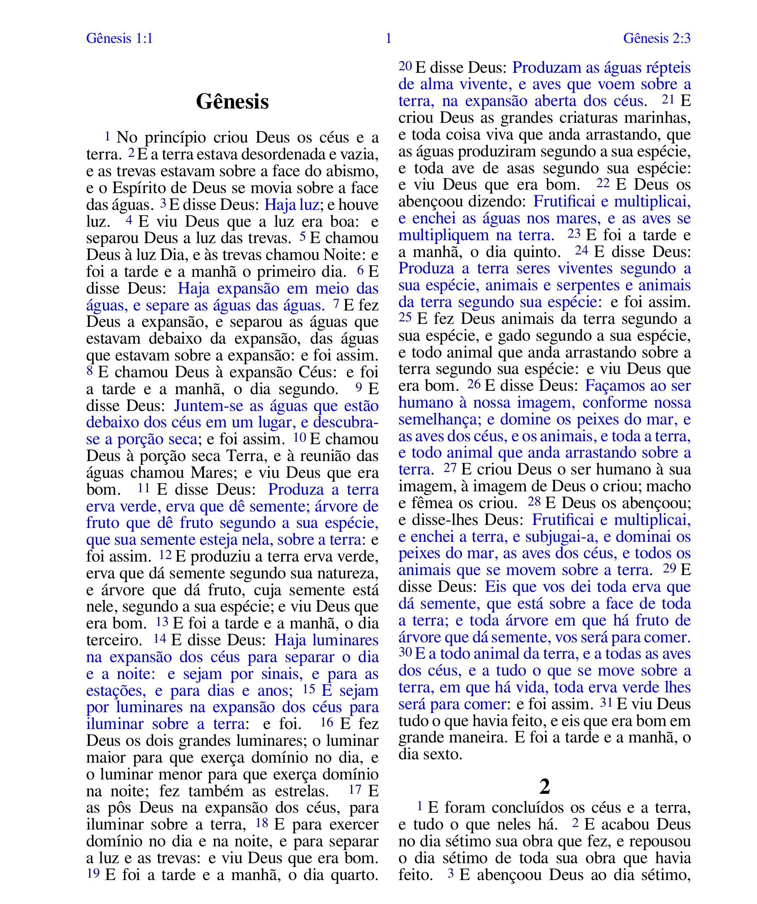

# BibliaLegendada
==================

<!--  -->
</img>

Bíblia Livre com adição de 'legendas'. A legenda consiste no uso de cores para melhor ilustração do discurso de cada personagem. 

## Propósito

Auxiliar leitores na compreensão e cultivar ainda mais o interesse pelos diálogos, parábolas e interlocuções presentes no texto bíblico.

## Ferramentas

O texto é formatado utilizando LaTeX (LuaLaTeX) para uma melhor organização e facilidade de execução de um texto tão imenso e detalhado.

Foram utilizados alguns Shell Scripts com expressões regulares para manipulação de caracteres.

## Progresso

### AT
### 📖 Livros do Antigo Testamento

<table>
  <tr>
    <!-- Coluna 1 -->
    <td valign="top" style="white-space: nowrap; padding-right: 20px;">
      <input type="checkbox" checked> Gênesis 
      <input type="checkbox" checked> Êxodo 
      <input type="checkbox" checked> Levítico 
      <input type="checkbox" checked> Números 
      <input type="checkbox" checked> Deuteronômio 
      <input type="checkbox" checked> Josué 
      <input type="checkbox" checked> Juízes 
      <input type="checkbox" checked> Rute 
      <input type="checkbox" checked> 1 Samuel 
      <input type="checkbox" checked> 2 Samuel 
      <input type="checkbox" checked> 1 Reis 
      <input type="checkbox" checked> 2 Reis 
      <input type="checkbox" checked> 1 Crônicas
    </td>
    <!-- Coluna 2 -->
    <td valign="top" style="white-space: nowrap; padding-right: 20px;">
      <input type="checkbox" checked> 2 Crônicas 
      <input type="checkbox" checked> Esdras 
      <input type="checkbox" checked> Neemias 
      <input type="checkbox"> Ester 
      <input type="checkbox"> Jó 
      <input type="checkbox"> Salmos 
      <input type="checkbox"> Provérbios 
      <input type="checkbox"> Eclesiastes 
      <input type="checkbox"> Cantares 
      <input type="checkbox"> Isaías 
      <input type="checkbox"> Jeremias 
      <input type="checkbox"> Lamentações 
      <input type="checkbox"> Ezequiel
    </td>
    <!-- Coluna 3 -->
    <td valign="top" style="white-space: nowrap; padding-right: 20px;">
      <input type="checkbox"> Daniel 
      <input type="checkbox"> Oseias 
      <input type="checkbox"> Joel 
      <input type="checkbox"> Amós 
      <input type="checkbox"> Obadias 
      <input type="checkbox"> Jonas 
      <input type="checkbox"> Miqueias 
      <input type="checkbox"> Naum 
      <input type="checkbox"> Habacuque 
      <input type="checkbox"> Sofonias 
      <input type="checkbox"> Ageu 
      <input type="checkbox"> Zacarias 
      <input type="checkbox"> Malaquias
    </td>
  </tr>
</table>

### NT

<table>
  <tr>
    <!-- Coluna 1 -->
    <td valign="top" style="white-space: nowrap; padding-right: 25px;">
      <input type="checkbox"> Mateus 
      <input type="checkbox"> Marcos 
      <input type="checkbox"> Lucas 
      <input type="checkbox"> João 
      <input type="checkbox"> Atos 
      <input type="checkbox"> Romanos 
      <input type="checkbox"> 1 Coríntios 
      <input type="checkbox"> 2 Coríntios 
      <input type="checkbox"> Gálatas
    </td>
    <!-- Coluna 2 -->
    <td valign="top" style="white-space: nowrap; padding-right: 25px;">
      <input type="checkbox"> Efésios 
      <input type="checkbox"> Filipenses 
      <input type="checkbox"> Colossenses 
      <input type="checkbox"> 1 Tessalonicenses 
      <input type="checkbox"> 2 Tessalonicenses 
      <input type="checkbox"> 1 Timóteo 
      <input type="checkbox"> 2 Timóteo 
      <input type="checkbox"> Tito 
      <input type="checkbox"> Filemom
    </td>
    <!-- Coluna 3 -->
    <td valign="top" style="white-space: nowrap;">
      <input type="checkbox"> Hebreus 
      <input type="checkbox"> Tiago 
      <input type="checkbox"> 1 Pedro 
      <input type="checkbox"> 2 Pedro 
      <input type="checkbox"> 1 João 
      <input type="checkbox"> 2 João 
      <input type="checkbox"> 3 João 
      <input type="checkbox"> Judas 
      <input type="checkbox"> Apocalipse
    </td>
  </tr>
</table>

## Versão do Texto Bíblico

Todas as Escrituras em português citadas são da Bíblia Livre (BLIVRE), Copyright © Diego Santos, Mario Sérgio, e Marco Teles, [Bíblia Livre](http://sites.google.com/site/biblialivre/) - fevereiro de 2018. Licença Creative Commons Atribuição 4.0 Brasil [Creative Commons Brasil 4.0](http://creativecommons.org/licenses/by/4.0/br/). Reprodução permitida desde que devidamente mencionados fonte e autores.

<!-- Ela tem como base o <i>Textus Receptus</i> no novo testamento.

## Contribuição

Todo o texto bíblico desta versão é LIVRE para uso. Nenhum valor é cobrado para uso ou download do texto ou do projeto na íntegra.

Existe um desejo de minha parte de criar uma versão impressa junto à uma casa publicadora, sem a necessidade de uma editora. Este passo, no entanto, é custoso e está aquém do orçamento do projeto.

Àqueles que desejarem, entretanto, apoiar o projeto ou abençoar o meu trabalho podem fazê-lo através das plataformas abaixo listadas:

Pix (Chave Aleatória) ->
BTC ->
--->
